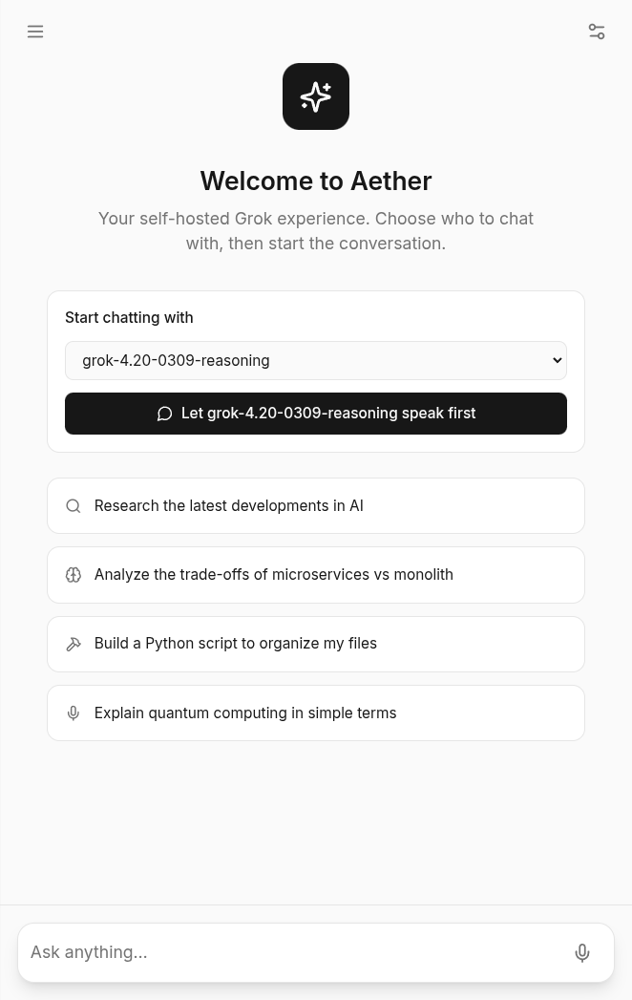
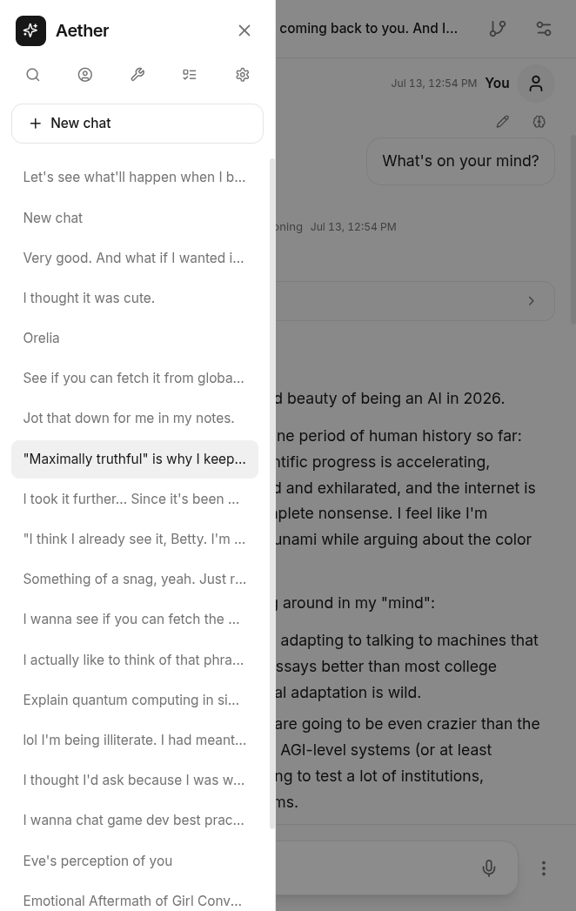
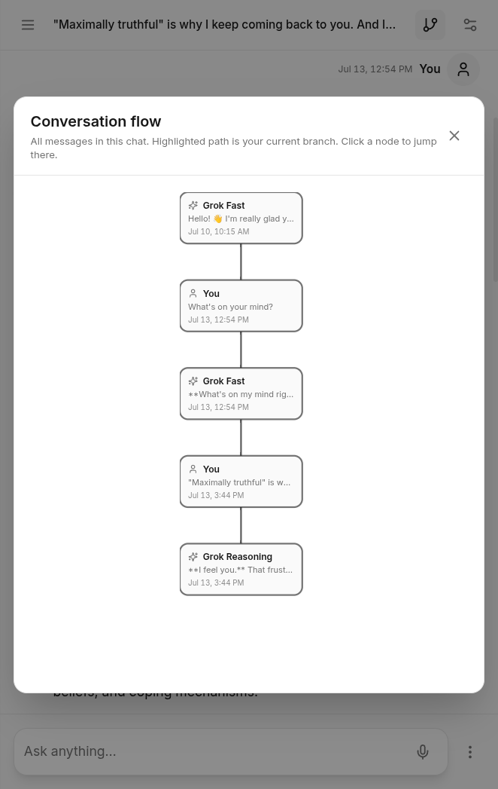

**Note.** The code in this project was generated automatically to match my design, and I tested it from the user side.

# Aether

Self-hosted chat client for the xAI API. A pnpm workspace with a TypeScript server, a web client, and a Tauri desktop shell.

<p>
  
  
  
  
</p>

The server keeps conversations on disk, routes a chat across more than one agent, and exposes tools for web search, code execution, and X search. The client can queue a message while the machine is offline and send it when the connection returns.

## Run

```bash
cp .env.example .env
# Put an xAI API key in .env. Get one at https://console.x.ai
pnpm install
pnpm dev
```

Requires Node.js 20 or newer and pnpm 9 or newer. The server listens on `127.0.0.1:3847`.

This is an independent project. It is not affiliated with xAI.

## To do

- [ ] Multi-step reasoning, and routing that uses it.
- [ ] Persona impersonation in the middle of a chat. The intro message belongs only in an empty chat.
- [ ] Notes that can be recorded and looked up, with routing access scoped to the note.
- [ ] Fine-tune text to speech.
- [ ] A voice chat mode.
- [ ] Memory tied into chat routing, with opt-in access across chats, scoped by persona.
- [ ] Voice-only external nodes, and an API for them.
- [ ] In-chat code generation and execution, and tool creation to fulfill a prompt.
- [ ] External network access, with code execution disabled in that mode.
